 

---

## `01` — Intro

B.Sc. Computer Science graduate from **Dr M.G.R. Educational and Research Institute, Chennai (2023–2026)**, based in Madhavaram, Chennai.

I build AI-driven applications with Python, prompt engineering and rule-based logic, and I've worked on live backend systems as a support intern. I'm looking for an **entry-level AI Engineer / Software Developer** role where I can grow into machine learning, data processing and intelligent application design.

---

## `02` — Selected Work

| | Project | What it does |
|---|---|---|
| **01** | **[AGRIVISION 38](https://github.com/mohansri1172005-lab)** — Smart Crop Recommendation for Tamil Nadu | Web platform that recommends optimal crops by district and season. A custom filtering engine processes climate data, soil types and seasonal factors — an early application of rule-based AI reasoning to a real dataset. |
| **02** | **[Aster & Thread](https://astra-thread.netlify.app)** — Tailoring & Fashion Service Website | Responsive site with service details, studio info, interactive tailoring workflow and an automated appointment booking form, optimised for all devices. |

---

## `03` — Skills

**Core competencies:** data analysis & filtering · problem-solving · backend troubleshooting · communication · teamwork · organisational skills
**Languages:** English (Full Professional) · Tamil (Native)

---

## `04` — Experience

**Backend Support Intern** — *Nine Stars Information Technologies Pvt. Ltd., Chennai* · Sept 2025
- Assisted with backend support operations, application maintenance and day-to-day technical activities.
- Monitored backend processes, verified data, maintained system records and troubleshot backend issues.
- Gained practical exposure to backend systems and IT support processes for maintaining data-driven applications.

## `05` — Education & Certification

- **B.Sc. Computer Science** — Dr M.G.R. Educational and Research Institute, Chennai · 2023–2026 · CGPA 6.58/10
- **Excel Champs** — Certificate of Excellence

---

## `06` — GitHub Stats

  

**Let's build something together →** [mohansri1172005@gmail.com](mailto:mohansri1172005@gmail.com)

